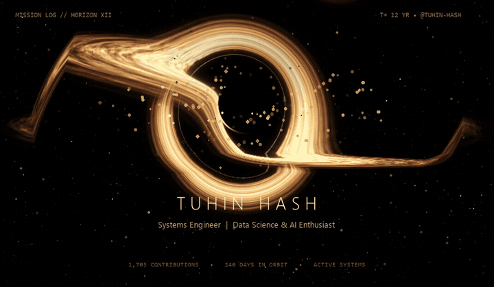
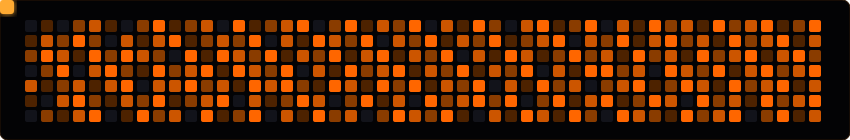

<div align="center">

<!-- CINEMATIC BLACK HOLE GALAXY HERO BANNER -->
<a href="assets/blackhole-profile.mp4" title="Click to view full cinematic video">
  
</a>

<br/><br/>

<!-- IDENTITY HEADER -->
<h1>
  <span style="color: #FFFFFF; font-weight: 800; letter-spacing: 2px;">TUHIN</span>
  <span style="color: #FF6600; font-weight: 800; letter-spacing: 2px;">PAUL</span>
</h1>

<p align="center">
  
  
  
</p>

<!-- TAGLINE -->
<p align="center">
  <em style="color: #FFAA33; font-size: 1.15em; font-family: monospace;">
    "Building intelligent solutions for a smarter tomorrow."
  </em>
</p>

<!-- ANIMATED TERMINAL TYPING SVG -->
<p align="center">
  <a href="https://github.com/tuhin-hash">
    
  </a>
</p>

<!-- QUICK NAVIGATION BADGES -->
<p align="center">
  <a href="#-about-me"></a>
  <a href="#-tech-stack"></a>
  <a href="#-flagship--featured-ai-projects"></a>
  <a href="#-github-telemetry--metrics"></a>
  <a href="#-connect-with-me"></a>
</p>


</div>

<br/>

<!-- =================================================== -->
<!-- ABOUT ME SECTION -->
<!-- =================================================== -->
## 🌌 About Me

```yaml
identity:
  name: Tuhin Paul
  role: AI Engineer & Data Scientist
  education: MSc Data Science @ REVA University, Bangalore
  core_focus:
    - Artificial Intelligence & Machine Learning
    - Transformer NLP & Computer Vision Architectures
    - Explainable AI (XAI) & Interpretability Frameworks
    - Enterprise Automation & Multi-Agent Simulations
  engineering_creed: "Translating mathematical rigor into resilient production intelligence."
```

- 🔭 **Postgraduate Researcher & Developer**: Pursuing an MSc in Data Science at **REVA University, Bangalore**, specializing in advanced machine learning, predictive modeling, and intelligent software engineering.
- 🧠 **AI Architecture & Deep Learning**: Engineering end-to-end intelligent pipelines spanning sequence-to-sequence transformer models (GED/GEC), multimodal threat classifiers, and multi-agent coordination systems.
- 🔍 **Explainable AI (XAI)**: Strong advocate for interpretability and auditability—integrating additive SHAP attributions, LIME surrogate explanations, and subgroup fairness evaluations into mission-critical models.
- ⚡ **Practical Problem Solving**: Building production-oriented solutions designed for high-stakes domains including cybersecurity risk assessment, emergency resource dispatch simulations, and smart agriculture optimization.
- 📈 **Continuous Evolution**: Relentlessly refining engineering standards across model evaluation, API microservices (FastAPI), modern frontend interfaces (React/Three.js), and cloud deployments.

<br/>

<div align="center">
  
</div>

<br/>

<!-- =================================================== -->
<!-- TECH STACK SECTION -->
<!-- =================================================== -->
## 🛰️ Tech Stack

<div align="center">

### 💻 Programming Languages
<p align="center">
  
  
  
  
  
  
</p>

### 📊 Data Science & Analytics
<p align="center">
  
  
  
  
  
</p>

### 🧠 AI / Machine Learning & Deep Learning
<p align="center">
  
  
  
  
  
  
  
</p>

### 📈 Business Intelligence & Visualization
<p align="center">
  
  
  
  
</p>

### 🛠️ Engineering, Frameworks & Automation
<p align="center">
  
  
  
  
  
  
  
</p>

### ☁️ Cloud & Infrastructure
<p align="center">
  
  
  
</p>

</div>

<br/>

<div align="center">
  
</div>

<br/>

<!-- =================================================== -->
<!-- FEATURED PROJECTS SECTION -->
<!-- =================================================== -->
## 🔮 Flagship & Featured AI Projects

<!-- FLAGSHIP PROJECT: SENTINELAI -->
<table width="100%">
  <tr>
    <td colspan="2" bgcolor="#0a0604">
      <h3 align="left">
        🛡️ <a href="https://github.com/tuhin-hash/SentinelAI"><b>SentinelAI</b></a>
        &nbsp;&nbsp;
        
        
      </h3>
    </td>
  </tr>
  <tr>
    <td width="65%" valign="top">
      <p>
        An enterprise-grade <b>AI-powered cybersecurity defense platform</b> engineered to identify, classify, and mitigate phishing URLs, fraudulent text messages, scam emails, and deceptive visual screenshots through real-time multi-modal risk scoring.
      </p>
      <ul>
        <li><b>Phishing URL Intelligence:</b> Lexical and behavioral feature extraction paired with high-precision machine learning classification.</li>
        <li><b>NLP Threat Parsing:</b> Semantic TF-IDF and NLP pipelines detecting deceptive linguistics across incoming correspondence.</li>
        <li><b>Visual OCR Pipeline:</b> Image-based scam detection extracting on-screen text with EasyOCR for contextual risk evaluation.</li>
        <li><b>Explainable AI Auditing:</b> Granular attribution scoring revealing contributing risk factors and threat indicators.</li>
      </ul>
      <p>
        
        
        
        
        
        
      </p>
    </td>
    <td width="35%" align="center" valign="middle">
      <a href="https://github.com/tuhin-hash/SentinelAI">
        
      </a>
      <br/><br/>
      <code style="color: #FFAA33;">Flagship AI Architecture</code>
    </td>
  </tr>
</table>

<br/>

<!-- GRID OF OTHER FEATURED PROJECTS -->
<table width="100%">
  <!-- ROW 1: CRISIS COMMAND & FARM WISE -->
  <tr>
    <td width="50%" valign="top">
      <h4>🚨 <a href="https://github.com/tuhin-hash/Crisis_command">Crisis Command</a></h4>
      <p>
        
        
      </p>
      <p>
        AI-assisted crisis intelligence and simulation platform for incident management, dynamic resource allocation, dispatch simulation, human-in-the-loop decisions, What-If analysis, counterfactual simulations, decision replay, geospatial visualization, and real-time audit tracking.
      </p>
      <p>
        <b>Tech Stack:</b> Python, FastAPI, LangGraph, LLM Decision Agents, React, TypeScript, Leaflet
      </p>
      <p align="right">
        <a href="https://github.com/tuhin-hash/Crisis_command"><b>Explore Crisis Command →</b></a>
      </p>
    </td>
    <td width="50%" valign="top">
      <h4>🌾 <a href="https://github.com/tuhin-hash/Farm-Wise">Farm Wise</a></h4>
      <p>
        
        
      </p>
      <p>
        Multi-agent AI-powered livestock farm decision-support system that optimizes feed formulation, analyzes costs and profits, evaluates environmental risks, and simulates possible outcomes to deliver explainable, data-driven recommendations for healthier animals and improved profitability.
      </p>
      <p>
        <b>Tech Stack:</b> TypeScript, React, Three.js, Multi-Agent Systems, Linear Optimization, Tailwind CSS
      </p>
      <p align="right">
        <a href="https://github.com/tuhin-hash/Farm-Wise"><b>Explore Farm Wise →</b></a>
      </p>
    </td>
  </tr>

  <!-- ROW 2: GRAMMERSENSE & N8N AUTOMATION -->
  <tr>
    <td width="50%" valign="top">
      <h4>✍️ <a href="https://github.com/tuhin-hash/GrammerSense">GrammerSense</a></h4>
      <p>
        
        
      </p>
      <p>
        Production-grade NLP system for Grammar Error Detection &amp; Correction (GED/GEC) using fine-tuned Hugging Face T5 Seq2Seq Transformers. Performs token-level localization, multi-candidate beam generation, and rigorous academic evaluation across GLEU, BLEU, and F0.5 metrics.
      </p>
      <p>
        <b>Tech Stack:</b> Python 3.12, PyTorch, Hugging Face Transformers, T5, FastAPI, React, Vite
      </p>
      <p align="right">
        <a href="https://github.com/tuhin-hash/GrammerSense"><b>Explore GrammerSense →</b></a>
      </p>
    </td>
    <td width="50%" valign="top">
      <h4>⚡ <a href="https://github.com/tuhin-hash/first_n8n_workflow">Customer Feedback &amp; Discount Automation</a></h4>
      <p>
        
        
      </p>
      <p>
        Intelligent customer feedback management pipeline built on n8n. Evaluates real-time submission sentiment using conditional rule logic, automatically generates and dispatches discount vouchers to qualified users, and synchronizes records directly into Google Sheets CRM.
      </p>
      <p>
        <b>Tech Stack:</b> n8n, Webhooks, Google Forms Trigger, Google Sheets API, Sentiment Logic
      </p>
      <p align="right">
        <a href="https://github.com/tuhin-hash/first_n8n_workflow"><b>Explore n8n Workflow →</b></a>
      </p>
    </td>
  </tr>

  <!-- ROW 3: 3D PORTFOLIO & SWIGGY SQL -->
  <tr>
    <td width="50%" valign="top">
      <h4>🌐 <a href="https://github.com/tuhin-hash/my-portfolio">Interactive 3D Developer Portfolio</a></h4>
      <p>
        
        
      </p>
      <p>
        Cinematic 3D personal portfolio featuring real-time procedural GLSL shaders, 22,000 particle morphing networks, momentum scroll physics (Lenis), and interactive showcases displaying technical milestones and live project monitors.
      </p>
      <p>
        <b>Live Demo:</b> <a href="https://my-portfolio-tuhin-hash.vercel.app">my-portfolio-tuhin-hash.vercel.app</a><br/>
        <b>Tech Stack:</b> React 18, Vite, Three.js, React Three Fiber, Custom GLSL Shaders
      </p>
      <p align="right">
        <a href="https://github.com/tuhin-hash/my-portfolio"><b>Explore Portfolio Repo →</b></a>
      </p>
    </td>
    <td width="50%" valign="top">
      <h4>📊 <a href="https://github.com/tuhin-hash/swiggy-sql-project">Swiggy SQL Business Intelligence</a></h4>
      <p>
        
        
      </p>
      <p>
        In-depth SQL business analysis exploring complex order flows, customer segmentation, restaurant performance metrics, delivery trends, and revenue revenue streams using multi-table joins, CTEs, and window functions.
      </p>
      <p>
        <b>Tech Stack:</b> MySQL, Advanced SQL, Window Functions, CTEs, Business Intelligence
      </p>
      <p align="right">
        <a href="https://github.com/tuhin-hash/swiggy-sql-project"><b>Explore SQL Analysis →</b></a>
      </p>
    </td>
  </tr>
</table>

<br/>

<div align="center">
  
</div>

<br/>

<!-- =================================================== -->
<!-- GITHUB STATISTICS SECTION -->
<!-- =================================================== -->
## 📊 GitHub Telemetry & Metrics

<div align="center">

<!-- STREAK STATS -->
<a href="https://github.com/tuhin-hash">
  
</a>

<br/><br/>

<!-- PROFILE SUMMARY CARDS (CYBERPUNK 2077 THEME) -->
<table border="0">
  <tr>
    <td align="center">
      
    </td>
    <td align="center">
      
    </td>
  </tr>
  <tr>
    <td align="center">
      
    </td>
    <td align="center">
      
    </td>
  </tr>
</table>

</div>

<br/>

<!-- =================================================== -->
<!-- CONTRIBUTION SNAKE SECTION -->
<!-- =================================================== -->
## 🐍 Contribution Cosmos

<div align="center">
  <p>
    <em>Autonomous contribution grid simulation — navigating daily commits across space:</em>
  </p>

  <picture>
    <source media="(prefers-color-scheme: dark)" srcset="https://raw.githubusercontent.com/tuhin-hash/tuhin-hash/output/github-contribution-grid-snake-dark.svg">
    <source media="(prefers-color-scheme: light)" srcset="https://raw.githubusercontent.com/tuhin-hash/tuhin-hash/output/github-contribution-grid-snake.svg">
    
  </picture>
</div>

<br/>

<div align="center">
  
</div>

<br/>

<!-- =================================================== -->
<!-- CURRENT FOCUS SECTION -->
<!-- =================================================== -->
## 🎯 Current Engineering Focus

<table width="100%">
  <tr>
    <td width="20%" align="center">
      <b>01. AI Engineering</b>
    </td>
    <td>
      Architecting production-ready AI services with FastAPI, asynchronous queues, model batching, and containerized microservice deployments.
    </td>
  </tr>
  <tr>
    <td width="20%" align="center">
      <b>02. Machine Learning</b>
    </td>
    <td>
      Designing supervised &amp; unsupervised predictive systems, fine-tuning modern architectures, and optimizing inference latency.
    </td>
  </tr>
  <tr>
    <td width="20%" align="center">
      <b>03. Explainable AI</b>
    </td>
    <td>
      Applying SHAP waterfall decompositions, LIME linear surrogates, and socio-demographic fairness audits to eliminate black-box opacity.
    </td>
  </tr>
  <tr>
    <td width="20%" align="center">
      <b>04. Cloud Deployment</b>
    </td>
    <td>
      Deploying data and ML infrastructure on AWS, establishing containerized runtime environments with Docker, and configuring CI/CD pipelines.
    </td>
  </tr>
  <tr>
    <td width="20%" align="center">
      <b>05. Automation Workflows</b>
    </td>
    <td>
      Building self-healing webhook automations, multi-agent LLM decision swarms, and data synchronization workflows using n8n and LangGraph.
    </td>
  </tr>
</table>

<br/>

<div align="center">
  
</div>

<br/>

<!-- =================================================== -->
<!-- CONNECT WITH ME SECTION -->
<!-- =================================================== -->
## 📡 Connect With Me

<p align="center">
  Let's collaborate on transformative AI, machine learning engineering, data science research, or autonomous systems!
</p>

<p align="center">
  <a href="https://www.linkedin.com/in/tuhinnpaul" target="_blank">
    
  </a>
  &nbsp;
  <a href="https://my-portfolio-tuhin-hash.vercel.app" target="_blank">
    
  </a>
  &nbsp;
  <a href="https://github.com/tuhin-hash" target="_blank">
    
  </a>
  &nbsp;
  <a href="mailto:tuhin16003@gmail.com">
    
  </a>
</p>

<br/>

<!-- =================================================== -->
<!-- FOOTER SECTION -->
<!-- =================================================== -->
<div align="center">


<br/>

<p style="font-family: monospace; letter-spacing: 4px; color: #FFAA33; font-weight: 700; font-size: 1.1em;">
  CODE • ANALYSE • INNOVATE
</p>

<p style="color: #888888; font-size: 0.9em;">
  Open to Opportunities &nbsp;|&nbsp; Always Learning &nbsp;|&nbsp; Bangalore, India
</p>

<p style="color: #444444; font-size: 0.8em;">
  © 2026 Tuhin Paul. Designed with cosmic precision for GitHub.
</p>

</div>
