<picture>
  <source media="(prefers-color-scheme: dark)" srcset="assets/singularity-hero-dark.svg">
  
</picture>

  <b>TUHIN PAUL</b> · Systems Engineer | Data Science &amp; AI Enthusiast · MSc Data Science @ REVA University

  
  &nbsp;
  
  &nbsp;
  
  &nbsp;
  
  &nbsp;
  

> **Mission brief.** Translating mathematical rigor into resilient production intelligence. Postgraduate Data Science researcher at REVA University specializing in AI engineering, Transformer architectures, Explainable AI (XAI), and multi-agent system simulations.
>
> **Current objective.** Architecting scalable end-to-end intelligent pipelines, optimizing inference latency across FastAPI microservices, and advancing interpretable decision systems for high-stakes domains.

---

### 🛰️ Mission Telemetry

<picture>
  <source media="(prefers-color-scheme: dark)" srcset="assets/singularity-telemetry-dark.svg">
  
</picture>

<b>Reading the instruments</b> (click to expand telemetry breakdown)

- **Accretion disk:** One particle per day of the last 365 days; brighter and closer to the event horizon signifies a busier contribution day. Three radial Keplerian bands spin at differential velocities (`28s`, `46s`, `76s`), mirroring real astrophysical accretion disks.
- **Relativistic beaming (Doppler effect):** The approaching side of the disk is amplified in brightness via horizontal gradient masking.
- **Orbit trajectory:** Monthly contribution volumes plotted as a closed Catmull-Rom spline curve; the pulsing radar beacon pinpoints the peak activity month (September 2026).
- **Spectral composition:** Primary language distribution by bytes across all public repositories.
- **Survey negative (Light theme):** Automatically renders as an inverted astronomical survey photographic plate when viewing in GitHub light mode.
- **Accessibility:** Motion is gracefully paused when your operating system or browser requests `prefers-reduced-motion`.

---

### 🚀 Flight Log (Featured Projects)

- `MSN-01` 🛡️ **[SentinelAI](https://github.com/tuhin-hash/SentineAII)** · Enterprise-grade AI cybersecurity defense platform detecting phishing URLs, scam SMS, and deceptive screenshots through multi-modal risk scoring, visual OCR, and Explainable AI (XAI) auditing.  
  `Python` · `Scikit-Learn` · `FastAPI` · `NLP` · `EasyOCR` · `React` · ★ *Flagship AI Architecture*

- `MSN-02` 🚨 **[Crisis Command](https://github.com/tuhin-hash/Crisis_command)** · AI-assisted crisis intelligence and emergency dispatch simulation engine featuring LangGraph decision agents, dynamic resource allocation, counterfactual What-If replay, and geospatial visualization.  
  `Python` · `FastAPI` · `LangGraph` · `LLM Agents` · `React` · `TypeScript` · `Leaflet`

- `MSN-03` 🌾 **[Farm Wise](https://github.com/tuhin-hash/Farm-Wise)** · Multi-agent AI livestock decision-support ecosystem optimizing feed formulation, profit margins, and environmental risk assessment with linear programming and explainable recommendations.  
  `TypeScript` · `React` · `Three.js` · `Linear Optimization` · `Multi-Agent AI` · `Tailwind CSS`

- `MSN-04` ✍️ **[GrammerSense](https://github.com/tuhin-hash/GrammerSense)** · Production NLP system for Grammar Error Detection &amp; Correction (GED/GEC) fine-tuned on Hugging Face T5 Seq2Seq Transformers with beam search and GLEU/BLEU evaluation benchmarks.  
  `Python 3.12` · `PyTorch` · `Hugging Face Transformers` · `T5` · `FastAPI` · `Vite`

- `MSN-05` ⚡ **[Customer Feedback &amp; Discount Automation](https://github.com/tuhin-hash/first_n8n_workflow)** · Autonomous customer sentiment evaluation and discount voucher dispatch workflow engineered on n8n with Google Sheets API synchronization and webhook integration.  
  `n8n` · `Webhooks` · `Google Sheets API` · `Automated Sentiment Analysis`

- `MSN-06` 🌐 **[Interactive 3D Developer Portfolio](https://github.com/tuhin-hash/My_Portfolio)** · Cinematic personal portfolio built with real-time procedural GLSL shaders, 22,000 particle morphing networks, and Lenis momentum physics.  
  `React 18` · `Three.js` · `React Three Fiber` · `GLSL Shaders` · [Live Demo](https://my-portfolio-tuhin-hash.vercel.app)

- `MSN-07` 📊 **[Swiggy SQL Business Intelligence](https://github.com/tuhin-hash/swiggy-sql-project)** · In-depth business analytics exploring order velocity, customer cohort retention, and restaurant revenue streams using advanced SQL, window functions, and CTEs.  
  `MySQL` · `Window Functions` · `Common Table Expressions` · `Data Analytics`

---

### 🛠️ Technical Arsenal

| Domain | Core Technologies & Frameworks |
| :--- | :--- |
| **Languages** | `Python` `SQL` `JavaScript` `TypeScript` `HTML5` `CSS3` |
| **AI / Machine Learning** | `PyTorch` `Hugging Face Transformers` `Scikit-Learn` `NLP` `LangGraph` `XAI (SHAP/LIME)` |
| **Data & Analytics** | `Pandas` `NumPy` `SciPy` `Seaborn` `Matplotlib` `Power BI` `Tableau` `Excel` |
| **Engineering & Web** | `FastAPI` `Docker` `n8n Automation` `React 18` `Three.js` `Git` `GitHub Actions` |
| **Cloud & Deployment** | `AWS` `Vercel` `RESTful Microservices` `Linux / Bash` |

---

### 🐍 Contribution Cosmos

  

    <em>Autonomous contribution grid simulation navigating daily commits across space:</em>
  

  <picture>
    <source media="(prefers-color-scheme: dark)" srcset="https://raw.githubusercontent.com/tuhin-hash/tuhin-hash/output/github-contribution-grid-snake-dark.svg">
    <source media="(prefers-color-scheme: light)" srcset="https://raw.githubusercontent.com/tuhin-hash/tuhin-hash/output/github-contribution-grid-snake.svg">
    
  </picture>

---

### 🎯 Core Engineering Pillars

<table width="100%">
  <tr>
    <td width="22%" align="center"><b>01. AI Engineering</b></td>
    <td>Architecting production-ready AI services with FastAPI, asynchronous queues, model batching, and containerized microservice deployments.</td>
  </tr>
  <tr>
    <td width="22%" align="center"><b>02. Machine Learning</b></td>
    <td>Designing supervised &amp; unsupervised predictive systems, fine-tuning sequence-to-sequence transformer models, and benchmarking inference performance.</td>
  </tr>
  <tr>
    <td width="22%" align="center"><b>03. Explainable AI</b></td>
    <td>Implementing SHAP feature attributions, LIME local surrogates, and fairness metrics to guarantee auditability in decision models.</td>
  </tr>
  <tr>
    <td width="22%" align="center"><b>04. Systems &amp; Automation</b></td>
    <td>Building resilient webhook integrations, autonomous multi-agent task simulations, and automated data pipelines using n8n and LangGraph.</td>
  </tr>
</table>

---

<picture>
  <source media="(prefers-color-scheme: dark)" srcset="assets/singularity-end-dark.svg">
  
</picture>

  
  &nbsp;
  
  &nbsp;
  
  &nbsp;
  

  CODE • ANALYSE • INNOVATE

  Bangalore, India &nbsp;|&nbsp; MSc Data Science @ REVA University &nbsp;|&nbsp; Open to Opportunities

Artwork and Singularity telemetry engine adapted from <a href="https://github.com/Dr-At0mic/README-Templates">README Templates</a> (Anandhu Suresh, GPL-3.0). Self-contained animated vector SVG. Motion pauses under prefers-reduced-motion.

